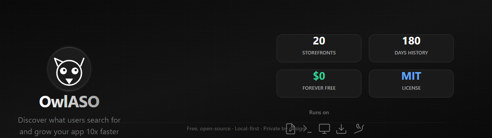
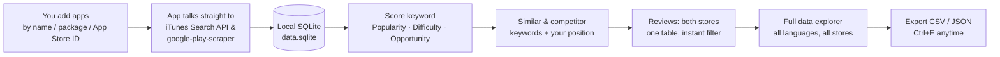

<div align="center">

<a href="https://github.com/owlaso/owlaso"></a>

<br />
<br />

**Free, open-source ASO keyword research.** Discover what users are searching for, analyze competitor strategies, and grow your app 10x faster — across both app stores.

<b><a href="https://github.com/owlaso/owlaso">App Repository</a></b> ·
<a href="https://github.com/owlaso/owlaso/issues/new">Report a bug</a> ·
<a href="https://github.com/owlaso/owlaso/issues">Request a feature</a> ·
<a href="https://github.com/owlaso/owlaso/releases">Releases</a> ·
<a href="https://owlaso.github.io/docs/">Documentation</a>

<br />

[](https://github.com/owlaso/owlaso/stargazers)
[](https://github.com/owlaso/owlaso/network/members)
[](https://github.com/owlaso/owlaso/watchers)
[](https://github.com/owlaso/owlaso/issues)
[](LICENSE)

[](https://github.com/owlaso/owlaso/commits)
[](https://github.com/owlaso/owlaso/pulse)
[](https://github.com/owlaso/owlaso)
[](https://github.com/owlaso/owlaso)
[](https://github.com/owlaso/owlaso/graphs/contributors)


[Features](#-features) ·
[How it works](#-how-it-works) ·
[Quick start](#-quick-start) ·
[Installation](#-installation) ·
[Privacy](#-private-by-design) ·
[FAQ](#-faq)

</div>

---

## 🎯 What is this?

Most ASO tools rank keywords by raw popularity, which mostly tells you what everyone already targets. **OwlASO ranks keywords by opportunity** — the intersection of demand you can actually compete for. A keyword with 80 popularity and 30 difficulty is a signal; 80 popularity and 90 difficulty is noise.

It's built for one person: an indie developer who builds apps and wants to grow on the App Store and Google Play without paying per seat or sending data to a SaaS. It runs on your machine, stores everything locally, and talks straight to the stores' public endpoints.

> [!NOTE]
> OwlASO is a local-first desktop app, not a SaaS. There are no accounts on someone else's server, no telemetry and no shared database. Your tracked apps, folders, keyword history and exports stay on your disk.

## ✨ Features

<table>
<tr>
<td width="50%" valign="top">

### 🔍 Keyword Research
- **Popularity, Difficulty, Opportunity** (0–100) computed from public signals
- **5 similar keywords** scored side by side in one query
- **Competitor keywords** — what the top apps also rank for
- **Your app's position** in the top 50 per store, daily change

</td>
<td width="50%" valign="top">

### 📊 Rank Tracking
- **Daily snapshots** with trend arrows & 30-day charts
- **180 days of history** kept locally
- **Track any app** — yours or competitors
- **Per-store, per-country, per-language**

</td>
</tr>
<tr>
<td valign="top">

### 🌍 All Countries at Once
- **20 storefronts** in one table, sorted by opportunity
- **Top Market badges** on the winners
- **Reviews from every App Store** storefront

</td>
<td valign="top">

### 💬 Reviews from Both Stores
- **Google Play + App Store** in one table with store column
- **Instant word & star filters**, highlighted matches
- **Compare up to 5 apps** with Ctrl/⌘-click
- **Step through reviews** with ← / → keys

</td>
</tr>
<tr>
<td valign="top">

### 🧪 Full-Data Explorer
- **Every reachable review** across stores & languages
- **Live progress** for each source
- **Filter by rating, store, language**; search & sort
- **What users complain about vs. love**

</td>
<td valign="top">

### 📤 Export Anything
- **CSV** for keywords, reviews & full data
- **JSON** for full-data results
- **Excel-ready UTF-8**, formula-injection safe
- **Press Ctrl/⌘+E** to export exactly what you're viewing

</td>
</tr>
</table>

### Also included

| Feature | Description |
|---|---|
| **Guided tour & help tooltips** | One-minute walkthrough + press `?` anytime |
| **Folders & drag-and-drop** | Organize apps & keywords your way |
| **Light / dark / system theme** | Matches OS until you pick |
| **Keyboard shortcuts** | Power-user workflow without the mouse |
| **Undo for deletes** | Accident-proof your data |
| **Screen-reader labels** | Full accessibility support |

## 🧠 How it works



1. **Add apps.** Click `+` (or press `A`) and search by name, package (`com.spotify.music`) or App Store ID. Apps on both stores merge into one entry.
2. **Analyze keywords.** Type a keyword and press `Enter`. You get scores for it and 5 similar keywords, plus any app's position on each store.
3. **Track ranks.** Daily snapshots fill in trend arrows and 30-day charts automatically. History kept locally for 180 days.
4. **Read reviews.** Switch to **Reviews**, filter by words and stars, compare apps, then press `Ctrl`/`⌘`+`E` to export.
5. **Go deeper.** **All Countries** runs one keyword across 20 storefronts. **Full Data** reads every reachable review across stores and languages.

## 🚀 Quick start

### Requirements

- **Node.js 22.12+** (for running from source)
- **Windows** (prebuilt installer), **macOS** or **Linux** (from source)
- **git** (for cloning & updates)

### Run from source (any OS)

```bash
git clone https://github.com/owlaso/owlaso.git
cd owlaso
npm install
npm run electron   # desktop app
```

Prefer the browser? Run `npm start` and open **http://localhost:3000**. Want an installer? `npm run dist:mac` builds a DMG, `npm run dist:linux` an AppImage.

### Windows installer (recommended)

1. Open the latest release on GitHub
2. Download `OwlASO.Setup.<version>.exe`
3. Run it — you get desktop & Start-menu shortcuts

> **SmartScreen warning?** If Windows shows "Windows protected your PC", choose *More info → Run anyway* — or build it yourself from source.

Rather not install? The release also ships a portable `.zip` you can unpack and run.

## 📦 Installation

| Platform | Method | Notes |
|---|---|---|
| **Windows** | Installer (`.exe`) | x64, auto-updates via GitHub Releases |
| **Windows** | Portable (`.zip`) | Unpack & run, no admin needed |
| **macOS** | `npm run dist:mac` | Builds a signed DMG |
| **Linux** | `npm run dist:linux` | Builds an AppImage |
| **Any OS** | `npm run electron` | Run from source (Node 22.12+) |

<details>
<summary><b>Build from source</b></summary>

```bash
git clone https://github.com/owlaso/owlaso.git
cd owlaso
npm install
npm run electron        # dev mode with hot reload
npm run dist:mac        # macOS DMG
npm run dist:linux      # Linux AppImage
npm run dist:win        # Windows NSIS installer
npm start               # web mode on http://localhost:3000
```

Requires **Node.js 22.12+** and **git**. See [docs/#install](https://owlaso.github.io/docs/#install) for full guide covering requirements, web mode and building installers.

</details>

## 🔐 Private by Design

<div align="center">

| | | |
|:---:|:---:|:---:|
| <svg width="24" height="24" viewBox="0 0 24 24" fill="none" stroke="currentColor" stroke-width="2"><path d="M12 22s8-4 8-10V5l-8-3-8 3v7c0 6 8 10 8 10z"/></svg> | <svg width="24" height="24" viewBox="0 0 24 24" fill="none" stroke="currentColor" stroke-width="2"><rect x="2" y="3" width="20" height="14" rx="2"/><line x1="8" y1="21" x2="16" y2="21"/><line x1="12" y1="17" x2="12" y2="21"/></svg> | <svg width="24" height="24" viewBox="0 0 24 24" fill="none" stroke="currentColor" stroke-width="2"><rect x="3" y="11" width="18" height="11" rx="2"/><path d="M7 11V7a5 5 0 0 1 10 0v4"/></svg> |
| **No telemetry** | **127.0.0.1 only** | **On-device** |
| Tracked apps, folders and keyword history stored on your device. No analytics, no OwlASO server. | Web mode binds to `127.0.0.1`, rejects foreign `Host` headers and cross-site requests (DNS-rebinding & CSRF protection). | Sandboxed renderer, context isolation, strict CSP, `http(s)`-only external links, every permission request denied. |

</div>

**Safe exports** — Review text starting with `=`, `+`, `-` or `@` is neutralised so a review can't run as a spreadsheet formula.

## 🗺️ App Pages

| Page | What it does |
|---|---|
| **Keywords** | Score a keyword + 5 similar, see positions, competitor keywords |
| **Keyword details** | All numbers, trend charts, best rank over time, top apps' keywords |
| **All Countries** | One keyword across 20 storefronts, sorted by opportunity |
| **Reviews** | Both stores in one table, instant word/star filter, compare apps |
| **Full Data** | Every reachable review, rating/store/language facets, search & sort |
| **Guided Tour** | One-minute walkthrough, press `?` anytime to replay |

## 📏 Transparent Scores

Every score is computed from public store data with a formula you can read — and check in the source.

| Score | Range | What it means | Formula |
|---|---|---|---|
| **Popularity** | 0–100 | How much demand a keyword shows, judged by the apps that rank for it | Rating volume (log) + breadth + avg stars + ad share |
| **Difficulty** | 0–100 | How hard it is to break into the results | Authority apps (≥50K) + ad share + breadth + ≥4★ share |
| **Opportunity** | 0–100 | High demand you can realistically compete for | `popularity × (100 − difficulty) / 100` |

> **Example** — "habit tracker": Popularity 78, Difficulty 64, Opportunity 28.  
> <details><summary>See the weights</summary>
> 
> **Popularity**: 40% rating volume, 22% breadth, 20% avg stars, 18% ad share  
> **Difficulty**: 40% authority apps, 25% ad share, 20% breadth, 15% ≥4★ apps
> 
> </details>

## 💡 Try the logic

A tiny preview of the scoring model — popularity, difficulty and the opportunity they add up to. The real app runs this across both stores and 20 storefronts.

```bash
# In the app: press the Command Dock (⌘K / Ctrl+K), type "habit tracker"
# P 78 · D 64 · O 28
```

## ❓ FAQ

<details>
<summary><b>Is OwlASO really free?</b></summary>

Yes. It's open source under the MIT license — no paid tier, no seats, no sign-up.

</details>

<details>
<summary><b>Where does the data come from?</b></summary>

**App Store:** Apple's public iTunes Search API and customer-review feed.  
**Google Play:** there is no official public reviews API, so OwlASO uses the open-source `google-play-scraper`, with an HTML fallback.

Requests go straight from your computer to the stores. Results are cached for 5–15 minutes to keep traffic low.

</details>

<details>
<summary><b>How accurate are popularity and difficulty?</b></summary>

They're estimates built from public signals (rating volume, star ratings, ads, result breadth), not Apple Search Ads' first-party data. They work best for comparing keywords against each other. [See the formulas](https://owlaso.github.io/docs/#metrics).

</details>

<details>
<summary><b>Why do I only get about 500 App Store reviews?</b></summary>

Apple's public review feed stops at 10 pages of 50 reviews per storefront (country). Pick **All Countries** to read every storefront at once. Google Play allows far more: up to 5,000 per fetch, and **Full Data** reads 1,000 per language — **Go Deeper** raises that to 5,000.

</details>

<details>
<summary><b>Is there a Mac or Linux version?</b></summary>

OwlASO runs on macOS and Linux from source today (Node.js 22.12+). The prebuilt installer is Windows-only for now; `npm run dist:mac` and `npm run dist:linux` build your own DMG or AppImage. [Install guide](https://owlaso.github.io/docs/#install).

</details>

<details>
<summary><b>Does rank history update by itself?</b></summary>

History is recorded whenever you analyze a keyword — one snapshot per day per keyword, store, country and language. Re-analyze your keywords on different days and the trend arrows and charts fill in.

</details>

<details>
<summary><b>Will the stores block me?</b></summary>

Normal use is fine. OwlASO caches results, merges duplicate requests and backs off when a store says "slow down" (it honours `Retry-After`). Hammering the stores with huge batches can still get you throttled for a while.

</details>

## ⭐ Star history

<a href="https://star-history.com/#owlaso/owlaso&Date">
  <picture>
    <source media="(prefers-color-scheme: dark)" srcset="https://api.star-history.com/svg?repos=owlaso/owlaso&type=Date&theme=dark" />
    
  </picture>
</a>

## 🤝 Contributing

Issues and pull requests are welcome.

1. [Fork the repo](https://github.com/owlaso/owlaso/fork) and create a branch: `git checkout -b my-change`
2. Make your change. Keep it local-first (no new external services without a toggle) and keep secrets out of the repo.
3. Check it compiles: `npm run build`
4. [Open a pull request](https://github.com/owlaso/owlaso/pulls) describing what changed and why.

Found a bug or have an idea? [Open an issue](https://github.com/owlaso/owlaso/issues/new).

## 📄 License

[MIT](LICENSE) © 2026 [alpernae](https://github.com/alpernae)

<div align="center">
<br />

<br />
<sub><b>OwlASO</b> · Discover what users search for and grow your app 10x faster</sub>
</div>